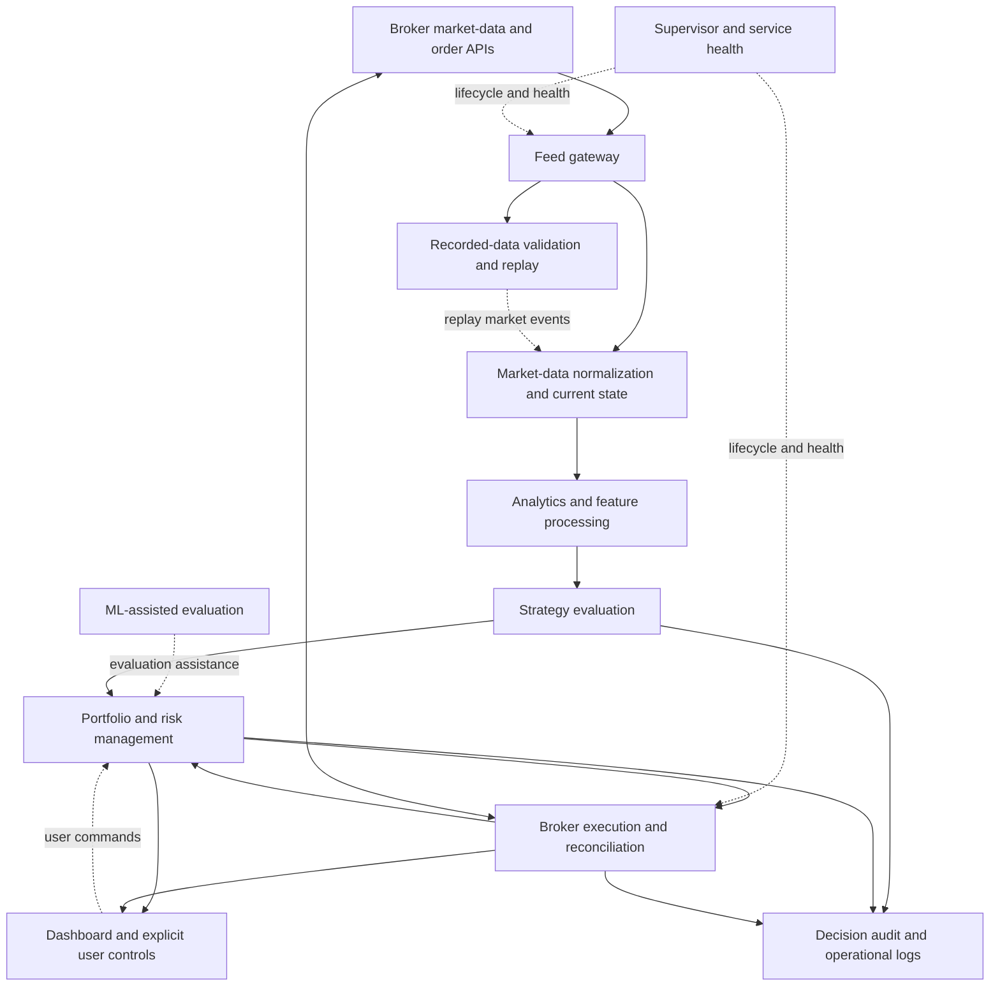

# AI-Based Autotrade Bot — Architecture Overview

**Author:** [Prabhat Hegde](https://github.com/phegde211)

**Private source repository:** [phegde211/ai-tradebot-pro](https://github.com/phegde211/ai-tradebot-pro)

The source repository is private. Please contact the author, Prabhat Hegde,
to request permission and access to the implementation.

This public overview is derived from the private repository's
`main/architecture.md`. It describes system structure and engineering
responsibilities. Strategy decision trees, proprietary ranking details,
configuration defaults, models, datasets, and implementation code are omitted.

## Purpose

An event-driven options-trading platform that separates market-data ingestion,
analytics, strategy evaluation, portfolio decisions, broker execution, and
operational visibility. Machine-learning assistance is integrated into the
evaluation pipeline alongside deterministic checks.

The architecture assigns a clear owner to each responsibility:

- Strategies propose candidates.
- Portfolio management controls admission, sizing, and position state.
- Execution owns communication with the broker.
- The dashboard presents state and submits explicit user commands.

## System topology

Arrows describe logical information flow. Runtime modules communicate through
an event bus; the diagram does not imply a direct function call between every
box or a universal one-process-per-box deployment requirement.

## Component responsibilities

| Component | Responsibility |
| --- | --- |
| Feed gateway | Receive live market data and publish raw events. |
| Market data | Normalize incoming data and maintain market state. |
| Analytics | Produce technical, derivatives, and contextual features. |
| Strategy engine | Evaluate opportunities and publish trade candidates. |
| ML integration | Provide model-derived evaluation assistance. |
| Portfolio management | Apply admission and capital controls, size positions, and track position state. |
| Execution | Submit permitted order intents, handle idempotency, and reconcile broker state. |
| Dashboard | Show positions, decisions, health, and explicit user controls. |
| Replay | Capture, validate, and replay historical market events through the evaluation pipeline. |
| Supervisor and audit | Manage service lifecycle and expose operational state and decision evidence. |

## Event-driven communication

Publish/subscribe contracts separate producers from consumers. Market data,
analytics, trade candidates, order intents, broker updates, and system health
have distinct event responsibilities.

The design distinguishes replaceable latest-state updates from ordered events
and durable business events. Queueing, checkpoints, and idempotent consumption
support recovery without treating every dashboard update as a durable fact.

## Recovery and validation

Recorded sessions can be validated and replayed against the same market-event
contract used by live consumers. Event-time handling supports reproducible
investigation of decisions rather than tying replay to the wall clock.

Durable state and broker reconciliation support restart recovery. Failure-domain
separation aims to contain a stalled component and expose its condition through
health signals. New-entry admission and existing-position management are treated
as separate responsibilities.

## Engineering focus

- Separation of data, decision, portfolio, execution, and presentation concerns.
- Explicit event ownership and delivery contracts.
- ML assistance integrated with deterministic controls.
- Idempotent execution and broker reconciliation.
- Replay-based investigation, testing, and decision audit.
- Operational supervision and isolated component failure handling.

This is an architecture overview, not a performance claim or a reproducible
trading specification. The complete design, source code, models, and operational
configuration remain in the private repository linked above.
