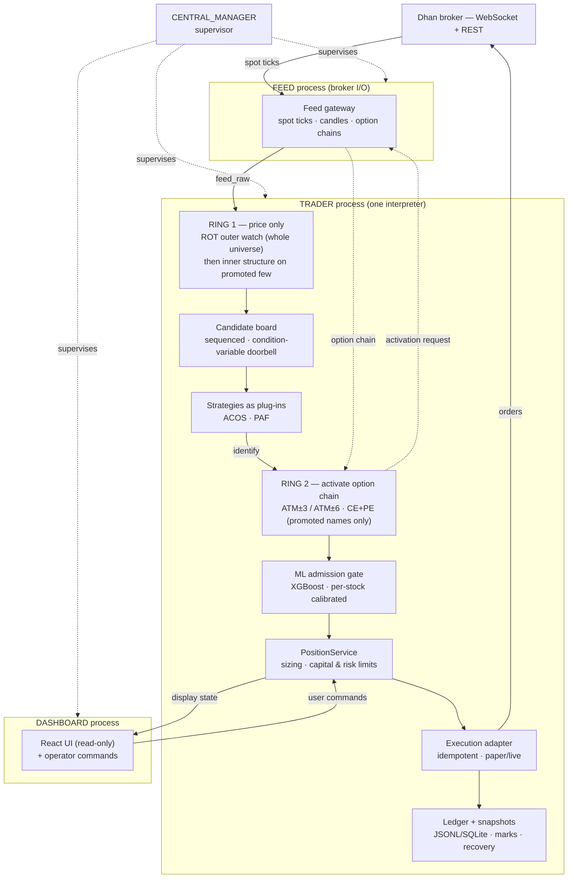

# AI Tradebot Pro — Architecture

**Author:** [Prabhat Hegde](https://github.com/phegde211)

**Private source repository:** [phegde211/ai-tradebot-pro](https://github.com/phegde211/ai-tradebot-pro)

The source repository is private. Please contact the author, Prabhat Hegde
([prabhat.hegde@gmail.com](mailto:prabhat.hegde@gmail.com)), to purchase or associate.

AI Tradebot Pro is an **event-driven intraday options-trading platform** for the
Indian F&O (futures & options) market. This document describes the **build
architecture** in full — the processes and how their dependencies are resolved, the
two-ring scouting design and the data-scale problem it solves, the decision workflow,
the concurrency and recovery model, the technology stack and the scale — derived from
the reviewed `redesign-4` branch (Section 0).

**Proven live.** The platform has been run in live markets against the **Dhan** broker
with real capital and has produced real profits. In technology stack and architecture it
is equivalent to a professional proprietary-trading desk and scales like one; the one
place it falls short of a well-funded desk is **access to deep historical and alternative
market data** — a data-access gap, not an engineering one.

Its defining *engineering* property is **modularity**: a strategy-agnostic spine into
which trading strategies plug as interchangeable components (Section 9). Its proprietary *core*
is the two strategies that plug into it — **ACOS** (Adaptive Cumulative Option Strategy)
and **PAF** (Price Action Follow-up) — the distillation of 20+ years of trading (Section 10).

> **What is withheld.** Only the **proprietary strategy decision rules** — what ACOS and
> PAF actually test for (decision-tree branches, entry/exit criteria, strike selection,
> scoring and thresholds) and the ML feature definitions — are omitted. The *workflow and
> structure* are shown in full; only the *rules inside each stage* are private.

---

## 0. Source repositories & branches

The work lives in **two separate private repositories**. The current platform is a
**single repository with multiple branches**; the earlier generation is a separate
repository. Latest is determined by commit date.

**Current platform — a single repo, multiple branches**
```
repo: github.com/phegde211/ai-tradebot-pro        (private)
   branches:
     main         2026-07-15   (obsolete)
     redesign-1   2026-07-19   (obsolete)
     redesign-2   2026-07-20   (obsolete)
     redesign-3   2026-07-26   (obsolete)
     redesign-4   2026-08-15   (LATEST — reviewed; this document describes it)
```

**Earlier generation — a separate repo, single branch**
```
repo: github.com/phegde211/AI_tradebot            (private)
   branches:
     main         2026-05-05   (obsolete — earlier TradingView/Playwright bridge)
```

Access to either is by request (contact above). This document describes
`ai-tradebot-pro @ redesign-4`.

---

## 1. Technology stack

| Layer | Technology | Role |
|---|---|---|
| Language / runtime | **Python 3.12**, OS processes, worker threads | Failure-domain isolation; one interpreter for coupled stages. |
| Inter-process bus | **ZeroMQ** (`pyzmq`) + **MessagePack** (`msgpack`) | Topic-based pub/sub with compact binary envelopes. |
| In-process bus | Custom `FeedBus` publish/subscribe | Connect TRADER stages with no network hop. |
| Ordered concurrency | Keyed dispatcher over a worker-thread pool | Per-symbol ordering, cross-symbol parallelism (Section 11). |
| Broker / market data | **Dhan** SDK (`dhanhq`), **WebSocket** feed (`websockets`, pinned), REST; **`pyotp`** (TOTP) | Ticks, candles, option chains, instruments, orders, reconciliation. |
| Numerics | **NumPy**, **pandas** | Time-series handling, feature prep, offline profile builds. |
| Options / indicators | **`py_vollib`** (Greeks/IV), **TA-Lib** (C-backed), **`ta`** | Derivatives math and technical indicators behind the (private) analytics. |
| Machine learning | **XGBoost**, **scikit-learn** | Gradient-boosted admission model from local artifacts; trained offline. |
| Columnar data | **Apache Parquet** via **PyArrow** | Per-stock history and deterministic profile artifacts. |
| Durable state | **SQLite** snapshots + append-only **JSONL** ledgers | Recovery independent of transport (Section 12). |
| Web backend | **FastAPI** + **Uvicorn** (+ Jinja2) | Dashboard API and streaming endpoints. |
| Frontend | **React 19**, **TypeScript**, **Vite**, **Material UI** (+ MUI X DataGrid), **Lightweight Charts**, Emotion | Typed operator UI, operational tables, streaming charts. |
| Frontend transport | **WebSockets** | Push changing state without full-page refreshes. |
| Verification | **pytest**, replay-regression harness, **ESLint** + Vite build | Data contracts, ordering, recovery, lifecycle, presentation. |

---

## 2. System architecture at a glance

The launcher starts **four operating-system processes**. Each is a failure domain: it
can crash and be restarted without corrupting the others.

```
                        system control / status
                   +------------------------------+
                   |        CENTRAL_MANAGER        |  supervisor — lifecycle,
                   |   readiness · alarms · start  |  readiness & health of all
                   +------------------------------+
                                  |  (supervises all three)
                                  v
  +-------------+   market data    +----------------+   display    +-------------+
  |    FEED     | ---------------> |     TRADER     | -----------> |  DASHBOARD  |
  |  Dhan I/O   | <--------------- | ROT·strategies | <----------- |  React UI   |
  | one broker  |  activation +    | analytics·risk |  user cmds   | (read-only) |
  |   owner     |  held state      | execution(ONE) |              +-------------+
  +-------------+                  +----------------+
```

| Process | Owns | Never does |
|---|---|---|
| **CENTRAL_MANAGER** | Startup, readiness, health, restart coordination, alarms. | Forward market data or make a trading decision. |
| **FEED** (`FEED_GATEWAY`) | Broker auth and all Dhan I/O: ticks, candles, dynamic option chains, history hydration, held-contract marks. | Run strategy, risk or position code. |
| **TRADER** | Every decision in one interpreter: ROT scout, strategies, analytics, position management, execution. | Shard itself across processes. |
| **DASHBOARD** | Read-only presentation + explicit operator commands. | Create a trading fact. |

### End-to-end flow — how a tick becomes a trade



Only **FEED** and **TRADER** sit on the market-to-order path.

---

## 3. Repository layout (`redesign-4`)

The code is organized as a set of single-responsibility **engine packages** behind the
four process entry points. The engine packages are the modular seams of Section 9; the
`strategy_engine` internals are the proprietary core (Section 10) and are deliberately
not enumerated here.

```
ai-tradebot-pro/
  services/                 process entry points + the orchestrator graph
    trader_process.py          TRADER: drains feed events, runs the graph
    feed_gateway_process.py    FEED: broker auth + all Dhan I/O
    dashboard_process.py       DASHBOARD: FastAPI + streaming state
    orchestrator_graph.py      builds the ONE graph used by runtime AND replay
    keyed_dispatcher.py        per-symbol-ordered, cross-symbol-parallel dispatch
    trader_state.py            periodic snapshots, reconciliation, stale-mark alarms
  core_engine/              transport + in-process bus (19 modules)
    zmq_bus.py                 the four ZMQ streams (feed_raw / trader_events / …)
  feed_engine/              market-data normalization, forming bars, subscriptions (25)
  stock_profiling/          ROT scout + offline per-stock profiles (40)
    rot_service.py             two-ring scout + the shared candidate board
    intrabar_intelligence.py   forming-bar + stock-relative references
    lookup.py                  sole cached runtime profile-lookup API
    profiles/                  built Parquet/JSON profile artifacts
    candles_5m/                210 per-stock, one-year, 5-min Parquet files
  strategy_engine/          ACOS and PAF strategies   (PROPRIETARY — not enumerated)
  ml_engine/                offline-trained admission model + inference boundary (9)
    inference.py               single production model loader
    models/                    promoted model + per-stock calibrated thresholds
  trade_engine/             PositionService: admission, sizing, risk, execution (48)
  replay_engine/            deterministic event-time replay + diagnostics (17)
  log_engine/               decision audit trail, JSONL ledgers, daily summaries (11)
  dashboard_engine/         React / TypeScript frontend (Vite, MUI, Lightweight Charts)
  visualization_engine/     offline charting / analysis views (8)
  config_engine/            configuration surface (3)
  research/                 offline backtesting, dataset builds, model training (79)
  scripts/                  start.sh / stop.sh, training & calibration entry points (13)
  post_mkt_analysis/        end-of-day bhavcopy -> next-day shortlist tooling
  architecture.md           the canonical architecture (this doc derives from it)
  requirements.txt   pytest.ini   redesign.md   replay.md   testing.md
```

Numbers in parentheses are the module (`.py`) counts in that package at `redesign-4` —
an indication of weight, not an invitation to read the strategy internals.

---

## 4. Why four isolated processes — and how dependencies are resolved

**The processes exchange information only through a typed message bus — never shared
memory, never a direct function call.** Four ZeroMQ pub/sub streams are the *entire*
inter-process surface (Section 5). Why:

- **Failure isolation.** The broker connection (FEED) is the least predictable part of
  the system — sockets drop, REST calls stall, tokens expire. Isolating it means a feed
  stall cannot take the decision engine down, and either side restarts independently.
- **Single owner per trading fact.** Exactly one process may *create* a given fact:
  market data is FEED's, every decision/position/order is TRADER's, presentation is
  DASH's. No process reaches into another's memory, so there is no shared-state
  corruption and every fact has one authoritative source.
- **The bus is not a database.** Messages are live state in flight, never replayed to
  rebuild state; recovery is from authoritative stores (Section 12).

**Dependency resolution without direct calls.** The hard case is a real cross-process
dependency: TRADER needs option-chain data that only FEED can fetch. It is resolved as a
published request/response over the bus, not a blocking call:

```
  TRADER identifies a candidate symbol
       |  publishes an activation event on trader_events   (5723)
       v
  FEED (subscribed) activates the dynamic option subscription for that symbol,
  hydrates bounded option history, and marks the held contracts
       |  publishes the option chain + marks on feed_raw    (5720)
       v
  TRADER consumes the chain and proceeds
```

TRADER never blocks on FEED and never calls into it; it emits intent and continues, and
the dependency is satisfied asynchronously when the data arrives as ordinary feed events.
**Inside TRADER it is the opposite choice:** the tightly-coupled stages share ordering and
state, so they run in **one interpreter on a single in-process `FeedBus`** — no network
hop, no serialization. The rule: *processes and the network exist only at failure-domain
boundaries; everything else is in-process* (Section 18).

---

## 5. Transport surface & schema

Four ZeroMQ streams (`core_engine/zmq_bus.py`) are the only use of the network — all
publish/subscribe with **MessagePack** envelopes, so a slow subscriber never blocks a
producer.

| Port | Stream | Owner → subscribers | Carries |
|---:|---|---|---|
| 5720 | `feed_raw` | FEED → TRADER, DASH | spot ticks, candles, option chains, feed status |
| 5723 | `trader_events` | TRADER → DASH, FEED | activation, held contracts, decisions, display state |
| 5726 | `system_events` | CENTRAL_MANAGER → all | readiness, alarms, start control |
| 5727 | `user_commands` | DASH → TRADER | explicit operator position commands |

Market events are keyed by symbol (`tick.<SYM>`, candle and chain topics) for topic-layer
filtering. Historical/profile data uses a columnar **Parquet** schema with a fixed
`timestamp, open, high, low, close, volume` contract, one file per stock.

---

## 6. FEED — market-data ownership

`services/feed_gateway_process.py` owns broker authentication and all Dhan I/O. It
subscribes to the F&O spot universe, publishes spot packets (`tick.<SYM>`) and completed
1- and 5-minute candles, maintains **dynamic** option subscriptions (activated on demand,
Section 4), hydrates bounded option history, retains subscriptions and marks for held contracts,
restores completed intraday spot history after a restart, and reports feed freshness. It
computes no Greeks, no ROT classification, no strategy, no risk and no positions.

A representative correctness detail it owns: **the Dhan tick volume is cumulative for the
session.** FEED publishes it unchanged; the forming-bar tracker derives each bucket's
volume from the *difference* between the current cumulative value and the bucket baseline
— never comparing the running day total against a five-minute reference — and handles
session reset, the auction-inclusive opening bucket, safe mid-session baselines after a
restart, and duplicate / out-of-order packets.

---

## 7. TRADER — the canonical pipeline

`services/trader_process.py` drains FEED events into a single graph built by
`services/orchestrator_graph.py`. **Runtime and replay use the same builder** (Section 13,
invariant 13).

```
  all spot ticks  (RING 1 — price only, whole universe: 210 stocks + 2 indices)
     -> ROT Ring 1 outer pass : cheap per-name participation watch, every tick
     -> ROT Ring 1 inner pass : structure / maturity / runway on the promoted few
     -> shared sequenced CANDIDATE BOARD   (a doorbell wakes every strategy)
          |-- ACOS   [pluggable strategy · decision rules private]
          |-- PAF    [pluggable strategy · decision rules private]
     -> RING 2 — activate OPTION CHAIN (ATM±3 / ATM±6, CE+PE) for identified names ONLY
     -> ML admission gate (XGBoost, offline-trained, per-stock calibrated)
     -> PositionService : admission, sizing, capital & risk limits
     -> paper / Dhan execution adapter (idempotent intents)
     -> mandatory stop / trailing · marks · ledger · dashboard state
```

---

## 8. ROT — two rings that tame an option-data explosion

`stock_profiling/rot_service.py`. **ROT is a scout, not a strategy** — it never emits a
trade. It exists to solve one problem of *scale*: the information burst you would face if
you tried to watch the whole market in option space.

### The information burst

A strategy ultimately trades **options**, and an option needs its ATM-centred chain live.
The universe is **210 F&O stocks + 2 indices = 212 underlyings**, and each needs *both*
sides of *several* strikes:

- stocks: **ATM ± 3 → 7 strikes × (CE + PE) = 14 option instruments** each;
- indices: wider and far more liquid — **ATM ± 6 → 13 strikes × (CE + PE) = 26** each.

```
  NAIVE — subscribe every option chain, universe-wide
  --------------------------------------------------------------------
    210 stocks  × 14 option instruments   = 2,940
      2 indices ×  26 option instruments   =    52
  --------------------------------------------------------------------
    ≈ 3,000 option instruments, EACH printing continuously — options
    tick far faster and noisier than spot — PLUS Greeks/IV recomputed
    on every one, on every tick.

         200 stocks that never set up today  ─┐
         are still blasting ~2,800 option      ├─►  a relentless firehose,
         feeds you will never trade  ─────────┘      ~99% of it pure waste.
```

You cannot watch the universe in option space. ROT's answer is to **split watching into
two rings — price first, options only when earned.**

### Ring 1 — price only (cheap, universe-wide)

Ring 1 subscribes just the **spot price** of all 212 underlyings — 212 lightweight
streams, *no option data at all*. ROT runs entirely here, in two passes:

```
  RING 1   —   SPOT PRICE ONLY   (all 210 stocks + 2 indices, every tick)
  ====================================================================
    outer pass : per-name participation watch; each name judged against
                 its OWN 5-min profile (no universal 2x / 4x / % threshold)
         |  promotes a small set
         v
    inner pass : structure · maturity · runway · pullback on the promoted
                 few, with an anti-thrash state machine:
                 NORMAL -> VOLUME_WATCH -> EARLY_IGNITION -> DIRECTIONAL_MOVE
         |
         v   only a DIRECTIONAL_MOVE with BOTH price and volume evidence
             is placed on the candidate board
  ====================================================================
    cost: O(212) but cheap — it is only price.   output: a handful of names.
```

### Ring 2 — the option chain (expensive, selective)

Only for a name that clears Ring 1 (and that a strategy then identifies, Section 4) does the
system **activate that name's option chain** and begin computing Greeks and analytics:

```
  RING 2   —   OPTION CHAIN   (only the handful Ring 1 promoted)
  ====================================================================
    promoted name
         |  activate ATM±3 (stock, 14 instruments) / ATM±6 (index, 26),
         |  CE + PE, + Greeks / analytics
         v
    dozens of option instruments live at once   —   NOT ~3,000
  ====================================================================
```

**The advantage.** Option-data churn and Greeks compute scale with the number of **live
opportunities**, not with the size of the universe:

```
                       universe-wide options        two-ring (price-gated)
   option feeds live        ~3,000  (always)          tens   (only active names)
   Greeks recompute         ~3,000 / tick             tens   / tick
   coverage                 full universe             full universe  (via price)
```

Full-universe coverage at **spot-price cost**, with heavy option bandwidth spent only
where a move has already proven itself on price. That is why ROT came into the picture —
and its central win.

### The shared candidate board & doorbell

`ROTCandidateBoard` is one bounded, sequenced deque guarded by a condition variable:

```
        ROT (producer)
           |  put()  -- deep-copies payload, assigns a monotonic sequence number,
           v            then signals the condition variable (the "doorbell")
   +-----------------------------------+
   |   bounded, sequenced candidate     |
   |   deque  (lag + overflow accounted)|
   +-----------------------------------+
      |                 |                \
      | ACOS cursor     | PAF cursor      \  non-consuming
      v                 v                  v  dashboard projection
   [  ACOS  ]        [  PAF   ]         [ RotCandidateBoard.tsx ]
```

Each strategy has an **independent cursor, so every strategy sees every candidate — they
are not competing consumers**, and none can starve another. `put()` wakes them immediately
(a doorbell, not a poll). Payloads are deep-copied; a candidate carries symbol, direction,
forming bar, raw profile references, calculated evidence, a stable opportunity ID,
promotion/expiry times and a sequence number.

---

## 9. Modularity — strategies are plug-ins (the engineering MVP)

The defining *engineering* property of the architecture is **modularity: the strategy
layer is fully pluggable.** Everything around a strategy — FEED, the ROT scout, the
candidate board, the ML admission gate, the PositionService and the execution adapter — is
a **strategy-agnostic spine.** A strategy is a component that plugs into that spine through
one uniform contract:

- it **subscribes to the candidate board** on its own independent cursor, so adding or
  removing one never disturbs the others (invariant 5);
- it **emits signals** into the single PositionService, which owns all admission, sizing
  and risk; and
- it is **registered with the strategy runner and gated by config**, so strategies can be
  enabled, disabled or run side by side with no change to the spine.

**ACOS** and **PAF** ship as two instances of that contract — the point is that they are
**interchangeable plug-ins, not wired-in special cases.** A new strategy is added by
implementing the same contract and taking a cursor on the board; the feed, scout, board,
ML gate, risk engine, execution adapter, recovery and replay harness are reused unchanged.
The spine neither knows nor cares *what* a strategy decides, only that it honours the
contract. Because every strategy reads the same board, the spine can even **compose** them:
when two independently confirm the same opportunity, PositionService may add at most one
extra lot under a separate risk slot — all limits still binding.

```
                         strategy-agnostic SPINE
   FEED -> ROT -> CANDIDATE BOARD ----+----> ML GATE -> POSITION -> EXECUTION
                                      |            (sizing/risk)   (adapter)
              plug in on a cursor --> |
                                      +--> [ ACOS ]  [ PAF ]  [ your next strategy ]
                                             ^ interchangeable plug-ins; spine unchanged
```

The same modularity runs through the whole system: each concern is its own engine package
(`feed_engine`, `strategy_engine`, `ml_engine`, `trade_engine`, `replay_engine`,
`dashboard_engine`, …) behind a contract; execution is an **adapter** (paper and live swap
behind one interface); ML sits behind a **single loader boundary**; and runtime and replay
are built by **one orchestrator graph**. Components are composed, not entangled — which is
what makes this a strategy *platform*, not one hard-coded bot.

---

## 10. The two strategies — 20 years of trading, distilled (the proprietary core)

Everything above is the *platform*. This section is the *edge*. **ACOS** (Adaptive
Cumulative Option Strategy) and **PAF** (Price Action Follow-up) are the distillation of
**20+ years of the author's hands-on market experience, codified into two strategies.**
They are the single most valuable — and most proprietary — part of the system. The modular
spine (Section 9) exists precisely so this hard-won logic can be expressed, protected, tested and
evolved as clean plug-ins instead of being tangled through the engine; the platform serves
the strategies, not the other way round.

What can be shown is the *shape* of their decision workflow. **The stages and their
ordering are shown; the criteria, branches and thresholds inside each stage are private.**

```
  candidate (from ROT board)
     -> STRATEGY EVALUATION
          ACOS : a decision tree classifies direction + strength
                 -> curated candlestick-pattern checks
                 -> phase-aware admission rules
                 -> two-phase: identify the stock, then activate the option
                    chain (Ring 2, Section 8) and select the strike
          PAF  : a price-action follow-up state machine over 5-min structure
                 and 1-min triggers
     -> ML ADMISSION GATE   (XGBoost; per-stock calibrated; can veto, never originates)
     -> POSITION SERVICE    (final admission, sizing, capital & risk limits)
     -> EXECUTION ADAPTER   (idempotent order intent -> paper or Dhan)
     -> mandatory stop / trailing, marks, ledger, dashboard state
```

The multi-stage shape — a **decision tree** for direction/strength, **candlestick-pattern**
recognition, **phase-aware admission**, a separately-trained **ML gate**, then independent
**risk** admission — is deliberate layering: cheap, explainable, deterministic checks run
first and gate the expensive and the learned stages, and risk is always the last word. What
each stage *tests for* is the proprietary edge and is not described here.

---

## 11. Concurrency & ordering

The receive thread does **no** strategy computation — it drains the socket and hands each
event to a **keyed dispatcher** (`services/keyed_dispatcher.py`):

```
   feed socket --> receive thread --> keyed dispatcher
                        |-- key=SYM_A --> [ ordered ] --\
                        |-- key=SYM_B --> [ ordered ]    >  run concurrently
                        |-- key=SYM_C --> [ ordered ] --/
```

Per-symbol events run in arrival order; different symbols run concurrently; there is **no
static sharding** (a busy key is resubmitted in turns so it cannot monopolize a worker);
and the socket keeps draining while work runs, so one slow symbol never backs up the feed.

---

## 12. State, restart & execution integrity

Recovery rests on one rule (Section 4): **transport is never the source of truth.** After any
restart — including mid-session — state is rebuilt from authoritative stores:

| Authoritative source | Restores |
|---|---|
| Append-only **JSONL** trade ledger | open/closed positions and the combined session count |
| **SQLite** snapshots / event logs | ACOS and PAF internal state |
| Dhan resubscription / snapshots | current live market state |
| Spot & option-history hydration | completed intraday context |
| **Broker reconciliation** | orders the broker acknowledged but the local side may not have recorded |
| Last-known-good local profile artifacts | per-stock reference data |

`services/trader_state.py` publishes snapshots to a **background writer**, so decision
callbacks never block on a SQLite commit; the queues are bounded and expose overflow.
Execution is the narrowest boundary: **idempotent order intents** (a retry/replay cannot
place a second real order — the broker is the authority), **continuous broker
reconciliation**, **mandatory protective exits** (a non-optional stop/trailing on every
position, updated in the same transition as marks and the ledger), and **one adapter
contract shared by paper and live**.

---

## 13. Deterministic replay

**Runtime and replay construct the same orchestrator graph.** A recorded session is fed
through the identical pipeline live consumers use, on an **event-time** clock with explicit
processing barriers, so the same inputs reproduce the same candidates, transitions and
orders — including newly activated option data. This makes "why did it take that trade?" a
repeatable question and doubles as a full-pipeline regression harness. A replay result is
an engineering artifact, never on its own a profitability claim.

---

## 14. Offline intelligence & the ML boundary

Per-stock behavioural profiles and the admission model are produced **entirely offline** and
consumed on the live path through a deterministic lookup boundary; **training and profile
generation never run during market hours.**

- **Live reads are deterministic artifact lookups** (`stock_profiling/lookup.py`) of pre-built
  Parquet/JSON profiles and baselines — no fitting on the hot path.
- **ML is an admission gate, not an oracle.** An **XGBoost** model scores candidates that have
  already passed deterministic checks; it can veto but never originates a trade. Its feature
  pipeline is **causal** (decision-time information only) and thresholds are **calibrated per
  stock**; a single production loader (`ml_engine/inference.py`) removes ambiguity about which
  model decided.
- **Data quality is explicit:** profile builds are atomic across the universe, and known
  corporate-action discontinuities are detected and their contaminated tail statistics excluded.

Feature definitions, counts and thresholds are private.

---

## 15. Dashboard boundary

`services/dashboard_process.py` (FastAPI backend, React/TypeScript frontend over WebSockets)
renders the outer universe and profile coverage, active inner-ring candidates, price/volume
evidence and maturity, feed freshness (including replay), independent per-strategy cursor lag,
and the position/confluence tables. It **consumes no candidate-board items and cannot affect
strategy delivery**; operator actions travel over `user_commands` and become explicit
`order.command` events inside TRADER. The UI presents truth and requests actions; it never *is*
the truth.

---

## 16. Reviewed scale

`redesign-4` snapshot — figures identify reviewed artifacts, not throughput or profitability:

| Dimension | Reviewed value |
|---|---|
| Watched universe | **210 F&O stocks + 2 indices = 212 underlyings** |
| Option subscription width | stocks **ATM ± 3** (14 CE/PE instruments); indices **ATM ± 6** (26) |
| Option feeds avoided by Ring 1/Ring 2 | **~3,000** instruments if pulled universe-wide → **tens** live at any moment |
| Stock-profile coverage | **210** requested, **210 built, 0 failed, 0 missing** |
| Historical series | **210** per-stock Parquet files (one-year, five-minute OHLCV) |
| ML model input | **111** features in the production model-input artifact |
| Runtime failure domains | **4** OS processes (supervisor + three children) |

---

## 17. Architectural invariants

1. A trading fact has one owner; everything else observes.
2. Internal TRADER stages stay in one interpreter, on the in-process `FeedBus`.
3. FEED never runs strategy, risk or position code.
4. ROT scouts; it never emits a trade or bypasses a strategy.
5. Each strategy receives every board candidate independently.
6. The receive thread never runs strategy computation inline.
7. Same-symbol event order is preserved end to end.
8. Profile training and research never run on the live path.
9. A forming candle never contaminates completed-candle history.
10. Dynamic option work (Ring 2) begins only after a strategy identifies a candidate.
11. Confluence adds at most one bounded lot and never bypasses risk controls.
12. Restart recovery comes from authoritative state, never transport history.
13. Backtest/replay and runtime construct the same graph.

---

## 18. Design evolution — why this shape

The four-process design is a deliberate consolidation. An earlier version was **sharded across
many processes** — separate analytics/strategy shards, separate portfolio and execution
processes, inter-stage durable spools and stage-specific ZMQ ports. That bought little and cost
much: every stage boundary became a serialization point, a recovery problem, an ordering hazard
and another thing to monitor, all to parallelize work that was never the bottleneck. It was
retired in favour of the rule used throughout — **processes and the network exist only at
failure-domain boundaries** — with the decision domain pulled back into one interpreter where a
keyed dispatcher (Section 11) recovers all the useful concurrency without any cross-process handoff. The
payoffs are visible throughout: recovery reads authoritative state instead of draining spools
(Section 12); ordering is a local guarantee, not a distributed protocol (Section 11); stage-to-stage handoff is
an in-process condition variable, not a networked queue (Section 8); and the whole pipeline reconstructs
deterministically for replay because it is one graph in one place (Section 13).

---

*This is an architecture and technology overview. The ACOS and PAF strategy rules, decision-tree
and ML feature definitions, datasets and operational configuration are proprietary and remain in
the private repository. To purchase or associate, contact Prabhat Hegde
([prabhat.hegde@gmail.com](mailto:prabhat.hegde@gmail.com)).*
